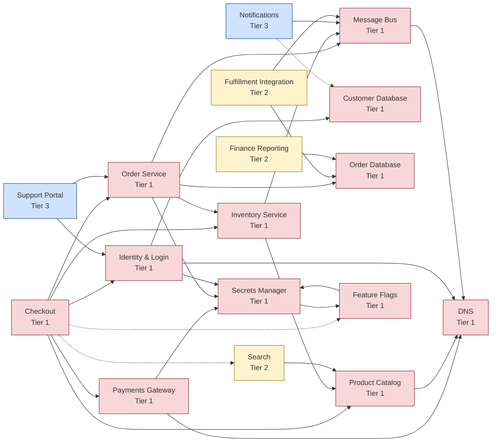

# Service Tiering Report

17 services. Tier 1: 12, Tier 2: 3, Tier 3: 2, Tier 4: 0.
19 findings: 13 high, 6 medium, 0 low.

## Tiers

| Service | Name | Owner | Max impact | MTPD (h) | RTO (h) | RPO (min) | Base tier | Final tier | Reason |
|---|---|---|---|---|---|---|---|---|---|
| catalog | Product Catalog | Commerce Eng | 3 | 24 | 8 | 60 | 2 | 1 | inherited from checkout |
| checkout | Checkout | Commerce Eng | 5 | 2 | 1 | 5 | 1 | 1 | impact/MTPD |
| customer-db | Customer Database | Data Platform | 4 | 8 | 2 | 5 | 2 | 1 | inherited from identity |
| dns | DNS | Network Eng | 5 | 4 | 1 | — | 1 | 1 | impact/MTPD |
| feature-flags | Feature Flags | Platform Eng | 3 | 72 | 24 | — | 3 | 1 | inherited from secrets |
| identity | Identity & Login | Platform Eng | 5 | 4 | 2 | 5 | 1 | 1 | impact/MTPD |
| inventory | Inventory Service | Supply Chain Eng | 4 | 24 | 8 | 15 | 2 | 1 | inherited from checkout |
| message-bus | Message Bus | Platform Eng | 5 | 8 | 2 | 0 | 1 | 1 | impact/MTPD |
| order-db | Order Database | Data Platform | 4 | 8 | 6 | 5 | 2 | 1 | inherited from orders |
| orders | Order Service | Commerce Eng | 4 | 8 | 4 | 5 | 2 | 1 | inherited from checkout |
| payments-gw | Payments Gateway | Payments Eng | 5 | 2 | 1 | 0 | 1 | 1 | impact/MTPD |
| secrets | Secrets Manager | Security Eng | 5 | 4 | 1 | 0 | 1 | 1 | impact/MTPD |
| fulfillment | Fulfillment Integration | Supply Chain Eng | 4 | 24 | 12 | 15 | 2 | 2 | impact/MTPD |
| reporting | Finance Reporting | Finance Systems | 4 | 72 | 48 | 1440 | 2 | 2 | impact/MTPD |
| search | Search | Discovery Eng | 4 | 24 | 8 | — | 2 | 2 | impact/MTPD |
| notifications | Notifications | Engagement Eng | 3 | 72 | 24 | — | 3 | 3 | impact/MTPD |
| support-portal | Support Portal | Support Ops | 3 | 48 | 24 | 60 | 3 | 3 | impact/MTPD |

## Findings

| Severity | Category | Service | Detail |
|---|---|---|---|
| High | Dependency cycle | feature-flags | Hard dependency cycle: feature-flags -> secrets. These services can only be recovered together; break the cycle or document a manual bootstrap procedure. |
| High | RTO exceeds tier standard | catalog | Tier 1 (inherited from checkout) allows up to 4h RTO; target is 8h. |
| High | RTO exceeds tier standard | feature-flags | Tier 1 (inherited from secrets) allows up to 4h RTO; target is 24h. |
| High | RTO exceeds tier standard | inventory | Tier 1 (inherited from checkout) allows up to 4h RTO; target is 8h. |
| High | RTO exceeds tier standard | order-db | Tier 1 (inherited from orders) allows up to 4h RTO; target is 6h. |
| High | RTO exceeds tier standard | reporting | Tier 2 (impact/MTPD) allows up to 24h RTO; target is 48h. |
| High | RTO inversion | checkout | checkout targets 1h RTO but hard dependency orders targets 4h. checkout cannot recover before orders. |
| High | RTO inversion | checkout | checkout targets 1h RTO but hard dependency identity targets 2h. checkout cannot recover before identity. |
| High | RTO inversion | checkout | checkout targets 1h RTO but hard dependency catalog targets 8h. checkout cannot recover before catalog. |
| High | RTO inversion | checkout | checkout targets 1h RTO but hard dependency inventory targets 8h. checkout cannot recover before inventory. |
| High | RTO inversion | orders | orders targets 4h RTO but hard dependency order-db targets 6h. orders cannot recover before order-db. |
| High | RTO inversion | orders | orders targets 4h RTO but hard dependency inventory targets 8h. orders cannot recover before inventory. |
| High | RTO inversion | secrets | secrets targets 1h RTO but hard dependency feature-flags targets 24h. secrets cannot recover before feature-flags. |
| Medium | Concentration risk | dns | 4 services hard-depend on dns: catalog, identity, message-bus, payments-gw. Confirm redundancy and include it in DR testing. |
| Medium | Concentration risk | message-bus | 4 services hard-depend on message-bus: fulfillment, inventory, notifications, orders. Confirm redundancy and include it in DR testing. |
| Medium | Concentration risk | secrets | 4 services hard-depend on secrets: feature-flags, identity, orders, payments-gw. Confirm redundancy and include it in DR testing. |
| Medium | Missing RPO | dns | Tier 1 service has no RPO target. |
| Medium | Missing RPO | feature-flags | Tier 1 service has no RPO target. |
| Medium | Missing RPO | search | Tier 2 service has no RPO target. |

## Recovery order

Each wave depends only on services in earlier waves. Within a wave, services are listed by tier.

1. customer-db (T1), dns (T1), feature-flags (T1, cycle), order-db (T1), secrets (T1, cycle)
2. catalog (T1), identity (T1), message-bus (T1), payments-gw (T1), reporting (T2)
3. inventory (T1), fulfillment (T2), search (T2), notifications (T3)
4. orders (T1)
5. checkout (T1), support-portal (T3)

## Dependency map

Solid arrows are hard dependencies; dotted arrows are soft.

